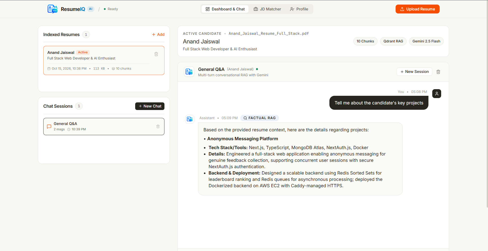
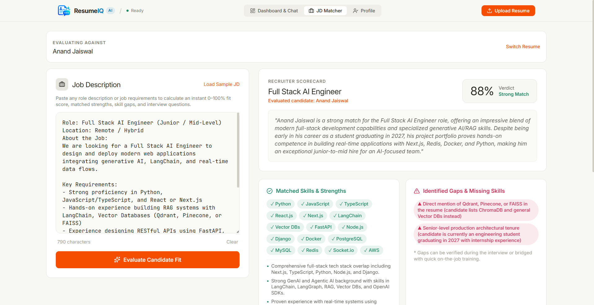
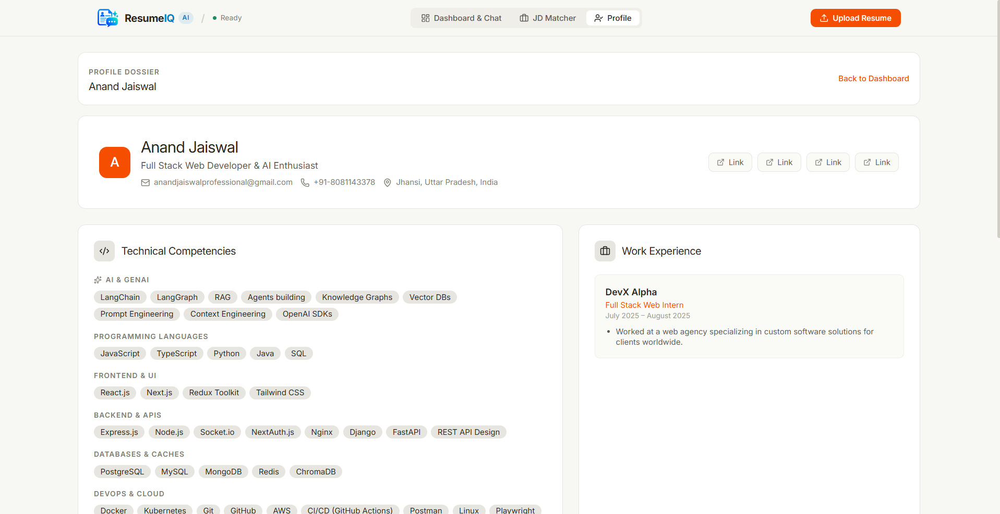

# 🚀 AI Resume Bot (Full-Stack RAG with Qdrant)

An interactive, context-aware AI Resume Bot powered by **LangChain + Gemini + Qdrant + FastAPI + React Router 7**.

---

## 🏛️ System Architecture

```text
[ Browser / Client ] ──── (HTTP / WebSocket) ──── [ React Router Frontend ] (Port 3000)
                                                          │
                                                          ▼
                                              [ FastAPI Backend ] (Port 8000)
                                               (LangChain LCEL RAG)
                                                  │             │
                                                  ▼             ▼
                                             [ Qdrant DB ]   [ Google Gemini ]
                                             (Port 6333)     (LLM & Embeddings)
```

- **Vector Database**: **Qdrant** containerized vector engine (persistent collections, cosine similarity, MMR re-ranking).
- **Backend API**: **FastAPI** (`server.py`) with REST endpoints and WebSocket token streaming (`/ws/chat`).
- **Frontend**: **React Router 7** + Tailwind CSS + Material-UI with bento box dashboard, light/dark mode, and real-time streaming chat.
- **CI/CD**: **GitHub Actions** end-to-end pipeline covering linting, pytest, typechecking, frontend bundling, Docker compose validation, and container image publishing to GitHub Container Registry (GHCR).

## Screenshots (Web UI)




---

## 🐳 Quick Start with Docker Compose

### 1. Configure Environment

Copy the example environment file and add your Google Gemini API key:

```bash
cp .env.example .env
```

Ensure `.env` contains:
```env
GOOGLE_API_KEY=your_actual_gemini_api_key_here
```

### 2. Launch Containers

Run with Docker Compose:

```bash
docker compose up --build
```

To run in the background (detached mode):
```bash
docker compose up --build -d
```

### 3. Access Services

| Service | URL | Description |
|---|---|---|
| **Web Frontend** | [http://localhost:3000](http://localhost:3000) | Full interactive Bento-grid web application |
| **FastAPI Backend** | [http://localhost:8000](http://localhost:8000) | REST API & WebSocket server |
| **Swagger Docs** | [http://localhost:8000/docs](http://localhost:8000/docs) | Interactive OpenAPI documentation |
| **Qdrant Dashboard** | [http://localhost:6333/dashboard](http://localhost:6333/dashboard) | Web UI for inspecting vector collections |

To shut down the services and remove containers:
```bash
docker compose down
```

To remove all volumes as well (resetting Qdrant storage):
```bash
docker compose down -v
```

---

## 🛠️ Local Development (Without Docker)

### Backend (Python 3.13 + uv)

```bash
cd backend
uv sync
uv run python server.py --host 0.0.0.0 --port 8000 --reload
```

Run test suite:
```bash
uv run python -m pytest tests/
```

### Frontend (Node 22)

```bash
cd frontend
npm install
npm run dev
```

---

## 🔄 CI/CD Pipelines (GitHub Actions)

The repository includes a complete end-to-end pipeline in `.github/workflows/ci-cd.yml`:

1. **Backend CI**: Sets up Python 3.13 and `uv`, installs dependencies, and runs the Pytest test suite with Qdrant vector store integration tests.
2. **Frontend CI**: Sets up Node.js 22, runs TypeScript `typecheck`, and verifies production build (`npm run build`).
3. **Docker Validation**: Runs on PRs and pushes to validate `docker compose config` and builds both backend and frontend images.
4. **CD Publish**: Automatically triggers on push to `main`/`master`, logs into GitHub Container Registry (`ghcr.io`), and publishes versioned and `latest` tagged multi-stage Docker images with GitHub Actions layer caching.
